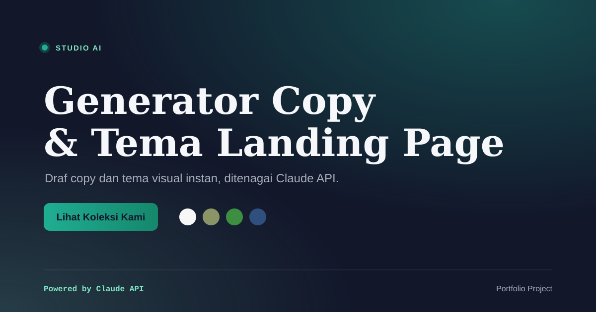

# Studio AI

> Generator copy & tema landing page instan, ditenagai Claude API



**Live demo:** [studio-ai-steel.vercel.app](https://studio-ai-steel.vercel.app)

---

## Apa ini?

Studio AI adalah dashboard satu-halaman: isi brief singkat (nama produk, industri, tone), AI generate 2-3 varian copy (headline/subheadline/CTA) + rekomendasi tema visual (palet warna + pasangan font), lalu langsung dirender di Live Preview Panel dengan animasi staged.

Dibuat sebagai portofolio untuk menunjukkan integrasi AI API secara *product-thinking* (bukan sekadar wrapper API) + kemampuan UI/UX (real-time preview, micro-interaction, empty/loading state yang didesain).

## Arsitektur Singkat

```
User isi form (nama produk, industri, tone)
  -> POST /api/generate
  -> Backend cek rate limit (max 5x/10menit per IP)
  -> Sanitasi input + susun prompt (pisah instruksi sistem vs data user)
  -> Panggil Anthropic Claude Haiku (provider utama)
     -> gagal/limit habis? -> fallback ke Gemini Flash
        -> gagal juga? -> fallback ke Groq (Llama 3)
  -> Parse & validasi JSON response (skema tetap sama walau beda provider)
     -> JSON invalid? -> retry 1x dengan instruksi lebih ketat
  -> Kirim hasil ke frontend
  -> Render: varian copy + swatch warna + Live Preview (animasi Framer Motion)
```


## Cara Install & Jalankan Lokal

```bash
git clone <repo-url>
cd studio-ai
npm install
cp .env.example .env.local
```

Isi `.env.local` minimal dengan `ANTHROPIC_API_KEY` (Gemini/Groq opsional, itu fallback):

```
ANTHROPIC_API_KEY=sk-ant-...
GEMINI_API_KEY=          # opsional, fallback
GROQ_API_KEY=             # opsional, fallback
```

Jalankan:

```bash
npm run dev
```

Buka `http://localhost:3000`.

### Jalankan test otomatis

```bash
npm test
```

24 test (parsing JSON dari AI, sanitasi input, rate limiting) — murni logic lokal, tidak butuh API key.

## Provider AI yang Didukung

| Provider | Model | Peran |
|---|---|---|
| Anthropic | Claude Haiku | Utama |
| Google Gemini | Gemini Flash | Fallback 1 |
| Groq | Llama 3 | Fallback 2 |

Semua gratis di tier awal masing-masing. Ganti/tambah API key tinggal edit `.env.local`, tidak perlu ubah kode — logic pemilihan provider ada di `src/lib/aiProvider.js`.

## Trade-off Desain

- **Kenapa Claude Haiku, bukan model besar?** Task-nya (generate copy + tema pendek) tidak butuh reasoning berat; Haiku cukup akurat, jauh lebih murah & cepat — cocok untuk demo interaktif real-time.
- **Kenapa fallback 3 lapis (Anthropic → Gemini → Groq)?** Supaya demo tetap jalan walau salah satu provider kena rate limit/kredit habis saat interview — reliability tanpa nambah biaya.
- **Kenapa single-page dashboard, bukan multi-halaman?** Fokus scope ke satu interaksi inti (brief → generate → preview) yang bisa didemo dalam <1 menit ke recruiter, daripada melebar ke banyak halaman.
- **Kenapa AI wajib kasih `reasoning` (alasan pilih warna/font)?** Supaya AI kelihatan "mikir" berdasarkan brief, bukan random generate — sekaligus jadi fitur transparansi (`theme.reasoning`, ditampilkan lewat tooltip ✨).
- **Kenapa ada rate limiter + sanitasi input padahal tanpa login?** Karena siapa saja bisa buka link publik ini dan menekan tombol Generate — tanpa guard, biaya API bisa bengkak walau kecil, dan rawan prompt injection lewat kolom nama produk.